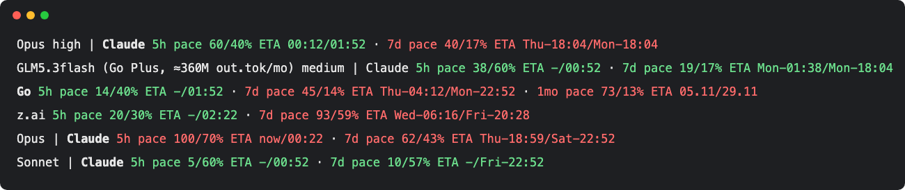

# claude-code-statusline-pace

A Claude Code status line that shows how fast you burn your subscription limits and **when the plan windows will run out**.



```
GLM5.3flash (Go Plus) medium ctx 42% | Claude     5h pace 38/60% ETA -/13:03                              · 7d pace 19/17% ETA Mon-13:49/Tue-06:15
                                       Fable                                                                7d pace 40/43% ETA -/Sun-11:03
                                       Go         5h pace 14/40% ETA -/14:03                              · 7d pace 45/14% ETA Thu-16:23/Tue-11:03 · 1mo pace 73/13% ETA 05.11/30.11
                                       z.ai       5h pace 20/30% ETA -/14:33                              · 7d pace 93/59% ETA Wed-18:27/Sat-08:39
                                       OpenRouter                              1d pace 31/42% ETA -/01:03 · 7d pace 30/43% ETA -/Sun-11:03
```

**What you get after install, with no setup:** the Claude row, plus a Fable row when your plan has a Fable weekly
limit (Max and above). The Go, z.ai and OpenRouter rows appear only when you point the plugin at a windows file you
keep yourself (see [Windows file](#windows-file-for-fable-go-zai-openrouter)). **Network:** the plugin reads Anthropic's
subscription usage endpoint every 5 minutes with Claude Code's own login (it never sees the token; option `oauthUsage`).

The screenshot stacks several cases, one per selected model: Opus (Claude only), a GLM model with a full windows file
(Claude, Fable, Go, z.ai and OpenRouter rows), an exhausted 5h window, and Sonnet. In a real session you see one block.
The wide gap between the `5h` and `7d` columns is the `1d` column, which only the OpenRouter row fills. Times are
illustrative.

| Part | Meaning |
| --- | --- |
| `GLM5.3flash (Go Plus) medium ctx 42%` | model name, effort level, and context fill (when enabled) |
| ` | ` | separator between the head and the Claude windows (row 1 only) |
| `Claude` / `Fable` / `Go` / `z.ai` / `OpenRouter` | plan label; **bold** for the plan behind the selected model |
| `5h` / `1d` / `7d` / `1mo` | the rate-limit window (kind order fixed) |
| `pace 38/60%` | used share of the limit / elapsed share of the window |
| `ETA 15:20/16:40` | when the limit hits 100% at the current burn / when the window resets |
| `ETA now/16:40` | the limit is already at 100% (red) |
| `ETA -/13:03` | at the current burn the limit will not run out before the reset |
| ` · ` | separator between windows of the same row |
| red / green | off-pace (red) or on-pace (green) |

**Columns are aligned** (monospace): each kind column has the width of its widest cell; a plan's missing kind is spaces.
The plan label is padded to the longest label among shown rows. Row 1 starts with the head; later rows indent by the same amount.

**How the ETA is computed.** Linear extrapolation: the used share per elapsed share of the window stays constant,
so `eta = now + (1 - used) / used * elapsed_time`. No history is stored; it is recomputed from the numbers the router or the engine passes on every refresh.

**Off-pace rules** (the same thresholds a pace-aware model router uses to stop sending work to a plan):
- **5h**: red when used > `max(1.5 × elapsed, 10%)` or used > 75%.
- **1d / 7d / 1mo**: red when used ≥ 90% **or** used > elapsed + 5%.
- Everything else is green.

## Install

### As a plugin (one command, no settings edit)

At the prompt of a Claude Code session in a terminal:

```
/plugin install statusline-pace --marketplace vespexx/claude-code-statusline-pace
```

Answer `y` to add the marketplace, then pick a scope (user scope loads it in every session). A pace band appears **above the prompt**: the model and effort, the plan's pace windows and the run-out ETAs — drawn by the plugin itself, with no `statusLine` setting and no Python.

From a shell:
```
claude plugin marketplace add vespexx/claude-code-statusline-pace && claude plugin install statusline-pace@statusline-pace
```

Remove it: `/plugin uninstall statusline-pace`.

The plugin needs a recent Claude Code (it uses the mods API, early access; tested on 2.1.311). It shows rate-limit figures for:
- **Claude** (Pro/Max subscription): 5h and 7d windows from the engine's rate limits; before the first answer of a session, from the subscription usage endpoint (below), else the windows file.
- **Fable**: the 7d window from the subscription usage endpoint (its `limits[]`, kind `weekly_scoped`; the endpoint is undocumented and may change, and then the Fable row is simply absent). Claude Code does not pass this window to plugins or the status line ([anthropics/claude-code#93107](https://github.com/anthropics/claude-code/issues/93107)), so the plugin asks `https://api.anthropic.com/api/oauth/usage` itself — the endpoint `/usage` reads — at most every 5 minutes. **In the plugin the token never reaches plugin code:** it calls `$.session.authorize()`, and Claude Code adds its own login header to that one first-party request. With an API key, a gateway or a 3P provider there is no such login and no request. Turn it off with the option `oauthUsage: false`. (The plain status line is different: see its own section; there the Fable row is opt-in and the script itself reads the token.)
- **OpenCode Go** (Go / Go Plus): 5h, 7d, and 1mo windows from the state file `plans.go`.
- **z.ai** (GLM via z.ai): 5h and 7d windows from the state file `plans.zai`.
- **OpenRouter**: from the state file `plans.openrouter`. The windows file decides what each window measures; the author's exporter writes `1d` = free-model requests used today / the daily request limit (a request count, not USD; resets 00:00 UTC) and `7d` = USD spent / the key's weekly budget. The plugin only draws the utilization it is given.
- The Claude row is shown whatever model is selected; the plan label of the selected model is bold.

**Without a windows file** (`stateFile` empty, the default) you get the Claude row (and the Fable row when your plan has a Fable limit), with no error. The Fable, Go, z.ai, and OpenRouter rows need a JSON file in the shape shown under [Windows file for Fable, Go, z.ai, OpenRouter](#windows-file-for-fable-go-zai-openrouter); no exporter for it is published here, so you write it yourself from the vendors' usage APIs (or leave it off).

**Important:** after installing or updating the plugin, **open a new Claude Code session** — long-lived sessions do not pick up reinstalled plugin rendering.

### Multiple band plugins above the prompt

Only one plugin can answer the `ui.render { component: "AbovePrompt" }` hook *without* calling `next(e)`. If a plugin above yours in the chain (alphabetical order within the `user` tier) answers instead of wrapping `next(e)`, the plugins below it never draw.

The `statusline-pace` plugin **always wraps `next(e)`** so other bands beneath it can coexist. If you do not see the pace band, check whether another plugin (e.g. `quote-reply`) sits above it alphabetically and answers without `next(e)`. Example: the upstream issue [vakovalskii/quote-reply#1](https://github.com/vakovalskii/quote-reply/issues/1) tracks fixing `quote-reply` to call `next(e)`.

The chain order within the `user` tier is alphabetical by plugin name, e.g. `paste-preview` → `quote-reply` → `statusline-pace`. To find the plugin that takes the band, disable the other above-prompt plugins one at a time (`/plugin disable <name>`), open a new session, and see when the pace band comes back.

### The plain status line (any Claude Code, needs Python 3)

Needs Python 3 (stdlib only). It reads the same data sources as the plugin and prints one or more lines to the status bar (Claude Code shows multi-line status line output).

```bash
curl -fsSL https://raw.githubusercontent.com/vespexx/claude-code-statusline-pace/main/statusline.py -o ~/.claude/statusline-pace.py
```

Merge this key into your existing `~/.claude/settings.json` (do not replace the file), then restart Claude Code. `statusLine` is a single setting: it **replaces any status line you already have**; to go back, restore your previous `command` (or delete the key). `refreshInterval` (seconds) keeps the ETA current while you are idle:

```json
{
  "statusLine": {
    "type": "command",
    "command": "python3 ~/.claude/statusline-pace.py",
    "refreshInterval": 60
  }
}
```

macOS/Linux. On Windows use `python` (or `py`) and a forward-slash absolute path, e.g. `"command": "python C:/Users/you/.claude/statusline-pace.py"`.

**With a windows file** (for Fable, Go, z.ai, OpenRouter rows), set the `PACE_STATE_FILE` env var in the command:

```json
{
  "statusLine": {
    "type": "command",
    "command": "PACE_STATE_FILE=~/.local/state/subscription-quotas/windows.json python3 ~/.claude/statusline-pace.py",
    "refreshInterval": 60
  }
}
```

**Fable row in the plain status line (opt-in):** a status-line command gets no credential handle from Claude Code, so the script can read the usage endpoint only with Claude Code's own login itself. Set `PACE_OAUTH=1` in the command to allow it: the script reads the token from the macOS keychain item `Claude Code-credentials` (or `~/.claude/.credentials.json` on Linux), sends it only to `api.anthropic.com` (redirects are refused), and caches only the parsed windows (`~/.cache/statusline-pace/oauth-usage.json`, mode 600, 5 minutes), never the token. Off by default.

**API-key (non-subscription) users** get no rate limits from Claude Code and no usage endpoint: the plugin draws no band, and the plain status line prints the model head alone.

### Plugin configuration

The plugin accepts these user-configurable options (set via `/plugin configure statusline-pace` or in `pluginConfigs` in `settings.json`):

| Option | Type | Default | Description |
| --- | --- | --- | --- |
| `showModel` | boolean | `true` | Show the model name and effort at the start of the band. |
| `showContext` | boolean | `false` | Show the context-window fill (`ctx 34%`) in the head. |
| `oauthUsage` | boolean | `true` | Read the subscription usage endpoint every 5 minutes for the Claude windows and the per-model weekly limits (Fable). Claude Code sends its own login; the plugin never sees the token. |
| `stateFile` | string | `""` | Path to the subscription-quotas exporter state file (`windows.json`) for the Fable (`plans.fable`), Go (`plans.go`), z.ai (`plans.zai`), OpenRouter (`plans.openrouter`) rows and the Claude fallback (`plans.claude` / `subscription`). `~/` expands to `$HOME`. Empty = off. |

Example `settings.json` snippet with a windows file:
```json
{
  "pluginConfigs": {
    "statusline-pace@statusline-pace": {
      "options": {
        "showModel": true,
        "showContext": false,
        "stateFile": "~/.local/state/subscription-quotas/windows.json"
      }
    }
  }
}
```

### Windows file for Fable, Go, z.ai, OpenRouter

The Fable (7d), Go (5h / 7d / 1mo), z.ai (5h / 7d), and OpenRouter (1d / 7d) windows come from a JSON file that some other tool keeps fresh. The author uses a private exporter (a launchd job, every 5 minutes, not published) that polls the vendor usage APIs and writes `~/.local/state/subscription-quotas/windows.json`; any tool that writes the same shape works. The file shape:
```json
{
  "updated": <epoch seconds>,
  "plans": {
    "claude": {"5h": {"utilization": 0.38, "reset": <epoch>}, "7d": {...}},
    "fable": {"7d": {"utilization": 0.4, "reset": <epoch>}},
    "go": {"5h": {...}, "7d": {...}, "1mo": {...}},
    "zai": {"5h": {...}, "7d": {...}},
    "openrouter": {"1d": {...}, "7d": {...}}
  }
}
```
- `utilization` is a 0..1 fraction (e.g., 0.38 = 38% used).
- `reset` is epoch seconds (UTC) when the window rolls over.
- A window or plan can be absent.
- The old router state shape `{"subscription": {"5h": {...}, "7d": {...}}}` still works as the Claude fallback (the plugin and the plain status line both accept it).
- The plugin reads that file via the `stateFile` option; the plain `statusline.py` in this repo reads the same file via `PACE_STATE_FILE` env var.

**Stale file handling:** when the state has a numeric top-level `updated` and `now - updated > 21600` s (6 hours), the plans from the file are ignored (treated as no data). No `updated` key → the data is used (old router shape).

**Kind `1d` (OpenRouter free daily requests):** length 86400 s, time format `HH:MM` (like `5h`). Off-pace rule = long-window rule (used ≥ 0.9 or used > elapsed + 0.05). Column order of kinds: 5h, 1d, 7d, 1mo.

**Plan row order:** Claude, Fable, Go, z.ai, OpenRouter. Display names: Claude, Fable, Go, z.ai, OpenRouter.

**Plan detection (`plan_of`/`planOf`):** 
- `fable` when the model id or label contains "fable" (checked before claude).
- `openrouter` when it contains "openrouter" (checked before claude).
- `go` for "opencode-go" or label items "Go"/"Go Plus".
- `zai` for "zai" in id or label item starting with "z.ai".
- `claude` for "subscription" in label items, or "claude"/"opus"/"sonnet"/"haiku" in id/label.

## Try it without Claude Code

Needs a clone of this repo (the one-file install has no `examples/`):

```bash
git clone https://github.com/vespexx/claude-code-statusline-pace && cd claude-code-statusline-pace
examples/run.sh   # renders examples/*.json with timestamps relative to now; a sibling <name>.state is used as the windows file
```

Or feed your own input; `resets_at` must be a near-future epoch (a 5h window resets within 5 hours):

```bash
echo "{\"model\":{\"display_name\":\"Opus\"},\"rate_limits\":{\"five_hour\":{\"used_percentage\":60,\"resets_at\":$(( $(date +%s) + 10800 ))}}}" | python3 statusline.py
```

Input fields used: `model.display_name`, `model.id`, `effort.level`, `rate_limits.five_hour|seven_day.{used_percentage,resets_at}` (epoch seconds or an ISO-8601 string), `context_window.used_percentage` (number, for ctx in head).
Missing fields are skipped; the script never raises, so a bad input cannot blank your status bar.

The screenshot is regenerated by `python3 scripts/make_screenshot.py` (needs Google Chrome).

## Tests

```bash
python3 -m unittest discover -s tests
```

For the plugin:
```bash
claude plugin test plugins/statusline-pace
claude plugin validate plugins/statusline-pace
```

## Notes

- The ETA is a straight-line estimate: a burst at the start of a window makes it pessimistic, an idle start optimistic.
- Times are in the local time zone of the machine running Claude Code. The 7d format uses a fixed English weekday list (Sun..Sat) so it does not depend on the locale.
- The band wraps to two rows when it does not fit on one line (`flexWrap: wrap`).
- Keep in sync: `plugins/statusline-pace/hooks/register.tsx` mirrors `statusline.py` function by function (`plan_of`, `short_label`, `off_pace`, `state_windows`, `fmt`).

## License

MIT