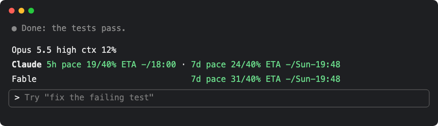
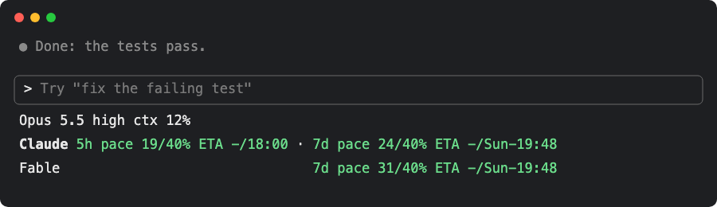
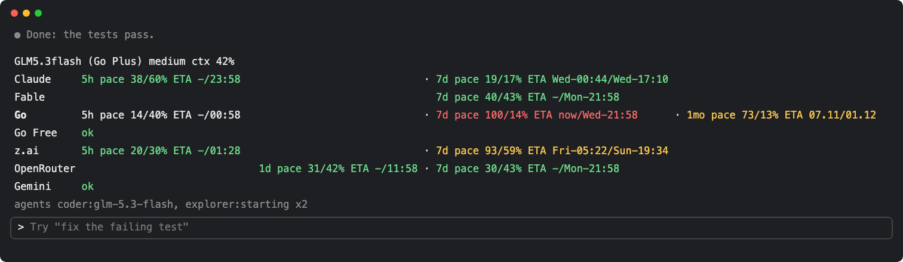
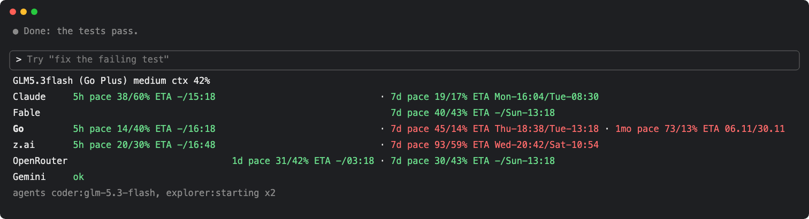

# claude-code-statusline-pace

Shows how fast you burn your Claude Code subscription limits and **when the plan windows will run out**: the used
share against the elapsed share of each window (5h, 7d, ...), a run-out ETA, yellow when you are ahead of pace and red when a limit is used up. A last
line lists the sub-agents running right now and the model each one really answered with.

**Current release: [v0.4.1](https://github.com/vespexx/claude-code-statusline-pace/releases/tag/v0.4.1)** —
[install it as a plugin](#a-plugin-band-above-the-prompt) or [as a status line](#b-status-line-below-the-prompt).

## Two ways to show it

The same rows, drawn by the same rules, in one of two places. Pick one (both at once show the rows twice): **A** when
your Claude Code is recent (2.1.311 or later) and you want to keep your own status line; **B** on any older Claude Code,
or when you want the rows below the prompt.

| | **A. Plugin** (band above the prompt) | **B. Status line** (below the prompt) |
| --- | --- | --- |
| Install | one `/plugin install` command | download one Python file, add `statusLine` to `settings.json` |
| Needs | a recent Claude Code with plugin mods (tested on 2.1.311) | any Claude Code, Python 3 (stdlib only) |
| Your existing status line | kept | replaced |
| Fable row (Max $100 and above) | on by default, the plugin never sees the token | opt-in `PACE_OAUTH=1`, the script reads the token itself |
| Other plans (Go, z.ai, OpenRouter, Gemini) | option `stateFile` | env `PACE_STATE_FILE` |

The text blocks under the pictures are the same examples rendered at another moment, so their clock times differ from
the pictures.

**Only a Claude subscription** (here Max $100, with its Fable weekly limit):

| A. Plugin | B. Status line |
| --- | --- |
|  |  |

```
Opus 5.5 high ctx 12%
Claude 5h pace 19/40% ETA -/16:04 · 7d pace 24/40% ETA -/Sun-17:52
Fable                               7d pace 31/40% ETA -/Sun-17:52
```

A: no setup after install. B: add `PACE_OAUTH=1` to the command for the Fable row (see [B](#b-status-line-below-the-prompt));
without it B shows the Claude row only. On Pro (no Fable limit) both show the Claude row only. One plan row is never
padded.

**Several subscriptions** (Claude, Fable, OpenCode Go, z.ai, OpenRouter, Gemini) from a [windows file](#windows-file-for-other-plans),
with three sub-agents running:

| A. Plugin |
| --- |
|  |

| B. Status line |
| --- |
|  |

```
GLM5.3flash (Go Plus) medium ctx 42%
Claude     5h pace 38/60% ETA -/15:18                              · 7d pace 19/17% ETA Mon-16:05/Tue-08:30
Fable                                                                7d pace 40/43% ETA -/Sun-13:18
Go         5h pace 14/40% ETA -/16:18                              · 7d pace 100/14% ETA now/Tue-13:18      · 1mo pace 73/13% ETA 06.11/30.11
z.ai       5h pace 20/30% ETA -/16:48                              · 7d pace 93/59% ETA Wed-20:42/Sat-10:54
OpenRouter                              1d pace 31/42% ETA -/03:18 · 7d pace 30/43% ETA -/Sun-13:18
Gemini     ok
agents coder:glm-5.3-flash, explorer:starting x2
```

The pictures are generated, not screen captures: the rows are the real output of `statusline.py` for
`examples/max-100.*` and `examples/all-plans.*`; the frame around them (a chat line, the prompt box) is a mock of the
Claude Code screen, and the times are relative to the moment of the run. The plugin draws the same rows:
`plugins/statusline-pace/tests/layout-cases.ts` holds both implementations to the same text. Regenerate with
`python3 scripts/make_screenshot.py` (needs Google Chrome).

## How to read it

| Part | Meaning |
| --- | --- |
| `Opus 5.5 high ctx 12%` | line 1: the selected model, effort level, and context fill |
| `Claude` / `Fable` / `Go` / `z.ai` / `OpenRouter` / `Gemini` | one row per plan, Claude first; **bold** = the plan behind the selected model |
| `5h` / `1d` / `7d` / `1mo` | the rate-limit window (column order fixed) |
| `pace 38/60%` | used share of the limit / elapsed share of the window |
| `ETA 15:20/16:40` | when the limit hits 100% at the current burn / when the window resets |
| `ETA now/16:40` | the limit is already used up (red) |
| `ETA -/13:03` | at the current burn the limit will not run out before the reset |
| ` · ` | separator between windows of the same row |
| `ok`, `slow 3.8-flash till 13:20` | a plan's status text from the windows file (green `ok`, else yellow), for plans without usage numbers |
| red / yellow / green / no colour | limit already used up (red), off pace (yellow), on pace (green), on pace in a row that already has a used-up limit (no colour) |
| `agents coder:glm-5.3-flash, explorer:starting x2` | last line, dim, only while sub-agents run: type and the model of its last answer (`starting` before the first); a sub-agent counts as running while its transcript was written in the last 120 s |

**Columns are aligned** (monospace): each window column has the width of its widest cell; a plan's missing window is
spaces, so the wide gap between `5h` and `7d` above is the `1d` column that only OpenRouter fills. The plan label is
padded to the longest label. A single plan row is not padded at all.

**How the ETA is computed.** Linear extrapolation: the used share per elapsed share of the window stays constant, so
`eta = now + (1 - used) / used * elapsed_time`. No history is stored; it is recomputed on every refresh.

**Colour rules** (the off-pace thresholds are the same a pace-aware model router uses to stop sending work to a plan):
- **Red**: the limit is already used up: used ≥ 100% and the window has not reset yet (`ETA now/...`).
- **5h**: yellow when used > `max(1.5 × elapsed, 10%)` or used > 75%.
- **1d / 7d / 1mo**: yellow when used ≥ 90% **or** used > elapsed + 5%.
- Everything else is on pace: green, or no colour when the same row has a used-up (red) window.

## Install

### A. Plugin: band above the prompt

Needs Claude Code 2.1.311 or later (plugin mods).

**Option 1: ask your AI.** Paste this text into Claude Code or another AI agent that can run shell commands:

```
Install the Claude Code plugin statusline-pace. Run these two commands in a shell, one after the other:

claude plugin marketplace add vespexx/claude-code-statusline-pace
claude plugin install statusline-pace@statusline-pace

If a command fails, show me the error and stop. When both commands succeed, tell me to open a new Claude Code session.
```

**Option 2: install it yourself.** Run the one-line installer:

```
curl -fsSL https://raw.githubusercontent.com/vespexx/claude-code-statusline-pace/main/scripts/install-plugin.sh | bash
```

Or, at the prompt of a Claude Code session:

```
/plugin install statusline-pace --marketplace vespexx/claude-code-statusline-pace
```

Answer `y` to add the marketplace, then pick a scope (user scope loads it in every session). If your Claude Code does
not know `--marketplace`, run this from a shell:

```
claude plugin marketplace add vespexx/claude-code-statusline-pace && claude plugin install statusline-pace@statusline-pace
```

**Open a new Claude Code session** after installing: a running session does not pick up the plugin.
Update later with `claude plugin marketplace update statusline-pace && claude plugin update
statusline-pace@statusline-pace` and a new session. Remove it with
`/plugin uninstall statusline-pace`.

What the plugin shows with no setup: line 1 with the model, then the Claude row (5h and 7d from the engine's rate
limits) and the Fable row when your plan has a Fable weekly limit. API-key, gateway and 3P users get no rate limits
from Claude Code and no usage endpoint, so the plugin draws nothing.

**Network:** for the Fable row the plugin asks `https://api.anthropic.com/api/oauth/usage` — the endpoint `/usage`
reads — at most every 5 minutes. Claude Code does not pass this window to plugins or the status line
([anthropics/claude-code#93107](https://github.com/anthropics/claude-code/issues/93107)). **The token never reaches
plugin code:** the plugin calls `$.session.authorize()`, and Claude Code adds its own login header to that one
first-party request. The endpoint is undocumented and may change; then the Fable row is simply absent. Turn it off with
the option `oauthUsage: false`.

#### Plugin options

Set via `/plugin configure statusline-pace` or in `pluginConfigs` in `settings.json`:

| Option | Type | Default | Description |
| --- | --- | --- | --- |
| `showModel` | boolean | `true` | Show line 1 (model, effort). |
| `showContext` | boolean | `true` | Show the context-window fill (`ctx 34%`) on line 1. |
| `oauthUsage` | boolean | `true` | Read the subscription usage endpoint every 5 minutes (Claude windows, Fable). |
| `stateFile` | string | `""` | Path to a [windows file](#windows-file-for-other-plans) for the other plans; `~/` expands to `$HOME`. Empty = off. |

```json
{
  "pluginConfigs": {
    "statusline-pace@statusline-pace": {
      "options": {
        "stateFile": "~/.local/state/subscription-quotas/windows.json"
      }
    }
  }
}
```

**Several bands above the prompt.** The plugin always wraps `next(e)`, so other above-prompt plugins beneath it still
draw. A plugin above it in the chain (alphabetical within the `user` tier) that answers without `next(e)` hides it; e.g.
[vakovalskii/quote-reply#1](https://github.com/vakovalskii/quote-reply/issues/1). To find such a plugin, disable the
others one at a time (`/plugin disable <name>`) and open a new session.

### B. Status line: below the prompt

Needs Python 3 (stdlib only). The status line **replaces the status line you have now**.

**Option 1: ask your AI.** Paste this text into Claude Code or another AI agent that can run shell commands:

```
Install the Claude Code status line statusline-pace. Do these steps in order:

1. Download https://raw.githubusercontent.com/vespexx/claude-code-statusline-pace/v0.4.1/statusline.py to ~/.claude/statusline-pace.py.
2. Make ~/.claude/statusline-pace.py executable.
3. If ~/.claude/settings.json exists, copy it to a backup file next to it.
4. Merge this key into ~/.claude/settings.json. Keep all other keys. Do not replace the file. If the file does not exist, create it with this key only:
   "statusLine": {"type": "command", "command": "python3 ~/.claude/statusline-pace.py", "refreshInterval": 60}
5. Tell me the backup path and the old statusLine value, if there was one.
6. Tell me to restart Claude Code.
```

**Option 2: install it yourself.** Run the one-line installer:

```
curl -fsSL https://raw.githubusercontent.com/vespexx/claude-code-statusline-pace/main/scripts/install-statusline.sh | bash
```

The installer downloads `statusline.py` and installs it to `~/.claude/statusline-pace.py`. Then it sets `statusLine` in
`~/.claude/settings.json`. It backs up both files first. To go back, restore your previous `command` from the
`settings.json.bak-<timestamp>` file that the installer prints.

Or download the script manually:

```
curl -fsSL https://raw.githubusercontent.com/vespexx/claude-code-statusline-pace/v0.4.1/statusline.py -o ~/.claude/statusline-pace.py
chmod +x ~/.claude/statusline-pace.py
```

The settings key: do this step only for a manual install, or when the installer prints "Add this key to ... by hand".
Merge this key into your `~/.claude/settings.json` (do not replace the file). `refreshInterval` (seconds) keeps the
ETA current while you are idle:

```json
{
  "statusLine": {
    "type": "command",
    "command": "python3 ~/.claude/statusline-pace.py",
    "refreshInterval": 60
  }
}
```

**Restart Claude Code** after installing.

For the Fable row, put the env var `PACE_OAUTH=1` in the command:

```json
"command": "PACE_OAUTH=1 python3 ~/.claude/statusline-pace.py"
```

On Windows use `python` (or `py`) and a forward-slash absolute path, e.g.
`"command": "python C:/Users/you/.claude/statusline-pace.py"`.

Options go into the command as env vars, e.g.
`"command": "PACE_OAUTH=1 PACE_STATE_FILE=~/.local/state/subscription-quotas/windows.json python3 ~/.claude/statusline-pace.py"`:

- `PACE_OAUTH=1` — the Fable row (opt-in). A status-line command gets no credential handle from Claude Code, so the
  script reads Claude Code's login itself: the macOS keychain item `Claude Code-credentials` (or
  `~/.claude/.credentials.json` on Linux). It sends the token only to `api.anthropic.com` (redirects are refused) and
  caches only the parsed windows (`~/.cache/statusline-pace/oauth-usage.json`, mode 600, 5 minutes), never the token.
- `PACE_STATE_FILE=<path>` — a [windows file](#windows-file-for-other-plans) for the other plans.

Without a subscription the script prints line 1 (the model) alone; the sub-agents line is added while sub-agents run.

## Windows file for other plans

Go, z.ai, OpenRouter, Gemini (and Fable, when you do not use the usage endpoint) come from a JSON file that some other
tool keeps fresh. Nothing in this repo fetches them for you: with no such file you get no Go, z.ai, OpenRouter or
Gemini row. The author runs a private exporter (every 5 minutes) that polls the vendors' usage APIs; any tool
that writes the same shape works. To write it by hand or from a cron job, use the generator (in a clone of this repo, or download it alone):

```bash
curl -fsSL https://raw.githubusercontent.com/vespexx/claude-code-statusline-pace/v0.4.1/scripts/make_windows.py -o make_windows.py
python3 make_windows.py --plan go 5h=14%@2026-11-04T18:00 7d=45%@2026-11-09T03:00 \
  --plan gemini status=ok -o ~/.local/state/subscription-quotas/windows.json
```

The shape:

```json
{
  "updated": 1793790000,
  "plans": {
    "claude": {"5h": {"utilization": 0.38, "reset": 1793800000}, "7d": {"utilization": 0.19, "reset": 1794300000}},
    "fable": {"7d": {"utilization": 0.4, "reset": 1794300000}},
    "go": {"5h": {}, "7d": {}, "1mo": {}},
    "zai": {"5h": {}, "7d": {}},
    "openrouter": {"1d": {}, "7d": {}},
    "gemini": {"status": "ok"}
  }
}
```

- `utilization` is a 0..1 fraction (0.38 = 38% used); `reset` is epoch seconds when the window rolls over.
- `status` (optional, any plan) is a short text, at most 40 characters: shown after the plan's windows, or alone when
  the plan has no windows. Green when it is `ok`, else yellow.
- A window or a plan can be absent. Rows are drawn in the order Claude, Fable, Go, z.ai, OpenRouter, Gemini.
- What a window measures is up to the writer. The author's exporter writes OpenRouter `1d` = free-model requests used
  today / the daily request limit (resets 00:00 UTC) and `7d` = USD spent / the key's weekly budget. Gemini's free tier
  has no usage API, so the author's router writes only a status (`ok`, or `slow <model> till HH:MM` while a Gemini model
  answers slowly).
- **Stale file:** when `now - updated > 21600` s (6 hours), the plans of the file are ignored. No `updated` key = the
  data is used.
- Claude's windows come from the engine (stdin `rate_limits` for the status line); the file's `plans.claude` (or the
  old router shape `{"subscription": {"5h": ..., "7d": ...}}`) is only the fallback before the first answer.
- The bold plan (the plan behind the selected model) is found by name: `fable` and `openrouter` first, then `gemini`,
  `go` (`opencode-go`, label `Go` / `Go Plus`), `zai`, then `claude` (`claude`, `opus`, `sonnet`, `haiku`, label
  `subscription`).

## Try it without Claude Code

```bash
git clone https://github.com/vespexx/claude-code-statusline-pace && cd claude-code-statusline-pace
examples/run.sh   # renders examples/*.json; a sibling <name>.state is the windows file
```

Or feed your own input; `resets_at` must be a near-future epoch:

```bash
echo "{\"model\":{\"display_name\":\"Opus\"},\"rate_limits\":{\"five_hour\":{\"used_percentage\":60,\"resets_at\":$(( $(date +%s) + 10800 ))}}}" | python3 statusline.py
```

Input fields used: `model.display_name`, `model.id`, `effort.level`,
`rate_limits.five_hour|seven_day.{used_percentage,resets_at}` (epoch seconds or ISO-8601),
`context_window.used_percentage`. Missing fields are skipped; the script never raises, so a bad input cannot blank your
status bar.

## Tests

```bash
python3 -m unittest discover -s tests
claude plugin test plugins/statusline-pace
claude plugin validate plugins/statusline-pace
```

## Notes

- The ETA is a straight-line estimate: a burst at the start of a window makes it pessimistic, an idle start optimistic.
- Times are in the local time zone. The 7d format uses a fixed English weekday list (Sun..Sat), not the locale.
- The plugin band wraps a row that does not fit the terminal width.
- `plugins/statusline-pace/hooks/register.tsx` mirrors `statusline.py` function by function; the shared
  `plugins/statusline-pace/tests/layout-cases.ts` (plain JSON after `export default`) fails both test suites when they
  drift apart.
- The sub-agents line reads the sub-agent transcripts under `<session transcript folder>/<session id>/subagents/`. The
  model is the one in the transcript (what really answered, e.g. after a gateway or router changed it). The plugin
  reads at most every 10 s and cannot read a transcript over 4 MiB (it shows `?` then).

## License

MIT
